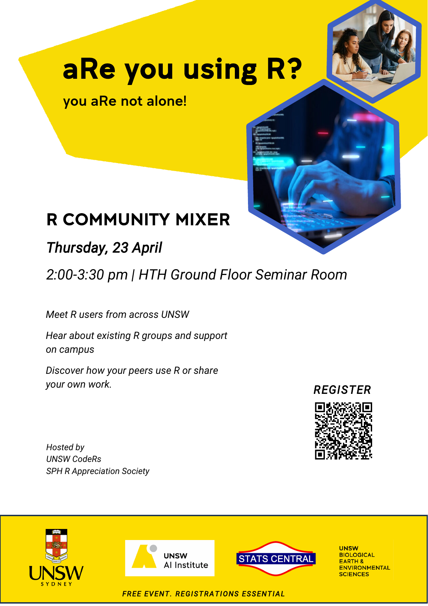
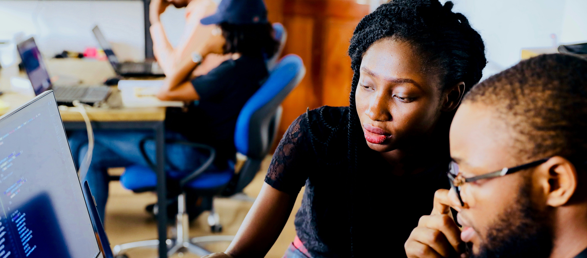

::: {.hero style="text-align:center;"}
Welcome to **UNSW codeRs** — a volunteer-run club at UNSW for anyone who uses (or wants to use) R for study, research, or fun.

We run regular workshops, maintain online resources, and provide a friendly space to ask questions, share projects, and learn together.
:::

::: {.mt-4 .mb-4 style="text-align:center;"}
[Get involved](#get-involved){.btn .btn-primary .me-2} [View calendar](calendar.qmd){.btn .btn-outline-primary}
:::

----

::: {.hero style="text-align:center;"}
## Upcoming event
:::

:::{.columns}
:::{.column width="50%"}
{width='90%'}
:::
:::{.column width="50%"}

### R community mixer

aRe you using R? Feeling isolated?

You R not alone!

Come hang out with fellow R enthusiasts in a relaxed, in-person setting. It’s a great chance to find out about R user support across the university, swap ideas, share projects, and pick up new tips—all while enjoying some good company. Whether you’re a newbie or a pro, this mixer is the perfect spot to connect and have fun with the R community. Don’t miss out on the good vibes and cool conversations!

Hosted by the UNSW codeRs Club and the R Appreciation Society, this is your chance to

Meet and mingle with other R users from all corners of the university
Discover R-related groups, initiatives, and support networks already active on campus
Share your projects and ideas in interactive sessions with other R users with similar interests.

All students and staff at any career stage are welcome. Come and meet someone new!

[Register here!](https://www.eventbrite.com.au/e/r-community-mixer-tickets-1985411810170).

Free event, registration is essential for catering purposes.
:::
:::

----

::: {.center style="text-align:center;"}
## What we do
:::

::::::::::: {.main-grid style="text-align:center;"}
:::: {.card .h-100}
{.card-img-top .modules-img}

::: {.card-body}
### Workshops

Hands-on R workshops during term and intensives between terms, covering R basics, data wrangling, visualisation, modelling, and more.

[View workshops](workshops.qmd){.btn .btn-outline-primary .btn-sm}
:::
::::

:::: {.card .h-100}
{.card-img-top .modules-img}

::: {.card-body}
### Online modules

Self-paced R learning modules on R & RStudio, dplyr, ggplot2, Quarto, and more.

[Browse modules](modules.qmd){.btn .btn-outline-primary .btn-sm}
:::
::::

:::: {.card .h-100}
{.card-img-top .modules-img}

::: {.card-body}
### Mentoring

One-on-one or small-group mentoring with more experienced R users.

[Mentoring info](mentoring.qmd){.btn .btn-outline-primary .btn-sm}
:::
::::

:::: {.card .h-100}
{.card-img-top .modules-img}

::: {.card-body}
### Help & community

A friendly help channel and community events for asking questions, debugging code, and sharing tips.

[Get help](help.qmd){.btn .btn-outline-primary .btn-sm}
:::
::::
:::::::::::

----

::: {.center-list style="text-align:center;"}
## Get involved

Whether you’re brand-new to R or an experienced user, there’s a place for you in UNSW codeRs.
:::

:::::: {layout-ncol=3 style="text-align:center;"}
::: {.center-list}
### If you’re new to R

  * Come to an **intro workshop**
  * Try the **“Getting started with R”** module
  * Join the help channel and say hi
:::

::: {.center-list}
### If you already use R

  * Attend intermediate/advanced workshops
  * Share your tricks in the help channel
  * Contribute to modules or examples
:::

::: {.center-list}
### If you want to volunteer

Because we’re **volunteer-run**, we always welcome:

  * Workshop presenters and helpers
  * Content writers and reviewers
  * Community / communiqué volunteers
:::
::::::

----

::: {.center-list style="text-align:center;"}
## Stay in touch

Stay up to date with workshops, modules, and opportunities:

  * Follow our announcements on the club channels
  * Join the mailing list
  * Keep an eye on this site for new material
:::

::: {.center-list style="text-align:center;"}
If you have ideas for workshops, modules, or collaborations, we’d love to hear from you!

[Contact us](about.qmd#contact){.btn .btn-primary}
:::