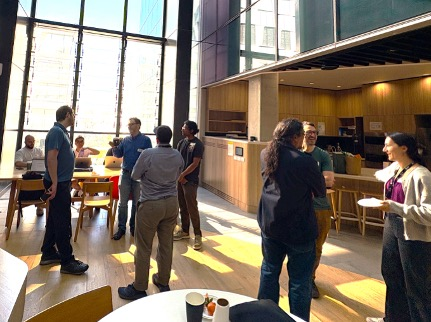

On 24 September 2026, UNSW codeRs hosted an R Cafe, with around 20 students and researchers from across UNSW joining. The event was an informal and friendly opportunity for R users to chat and code over tea, coffee and delicious treats!  
 
The event created a welcoming space for people at all stages of their R journey to connect, exchange ideas, and explore new tools and approaches. 

Feel free to spread the word about UNSW codeRs! We look forward to seeing you at more events in 2027! 